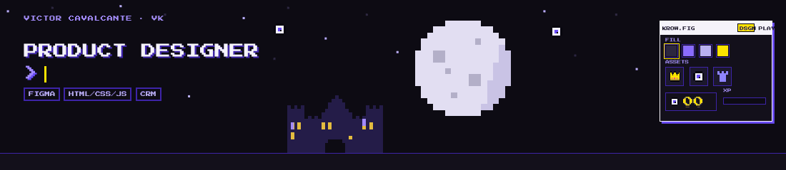

### Hi, I'm Vk. I design experiences, from research to release.

I've spent 6+ years designing apps, sites, platforms and games.

I started in game development, and it still shapes how I work. Rewards, progress and a good first minute are what make people come back, in a game or in a product. I take a feature from research and flows in Figma all the way to the code that ships it.

Lately I've been working on onboarding, gamification and retention: loyalty hubs, missions, stores, the screens that turn a visit into a habit.

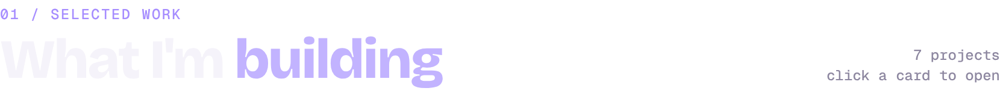

<a href="https://github.com/Victorvkdev/nozito">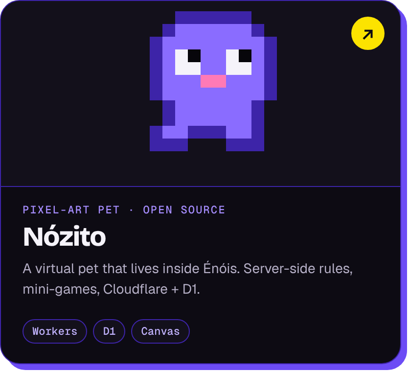</a>
<a href="https://github.com/Victorvkdev/victorvk-site">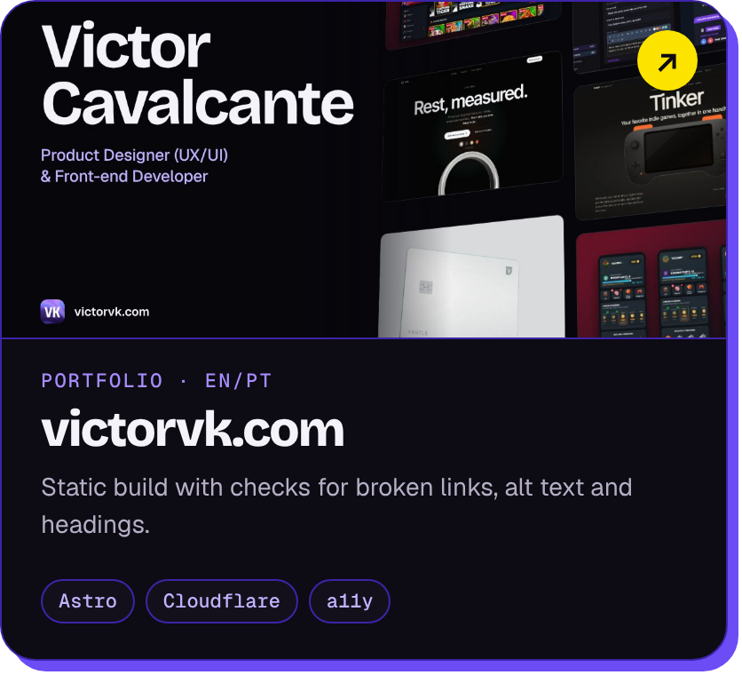</a>
<a href="https://github.com/Victorvkdev/tinker">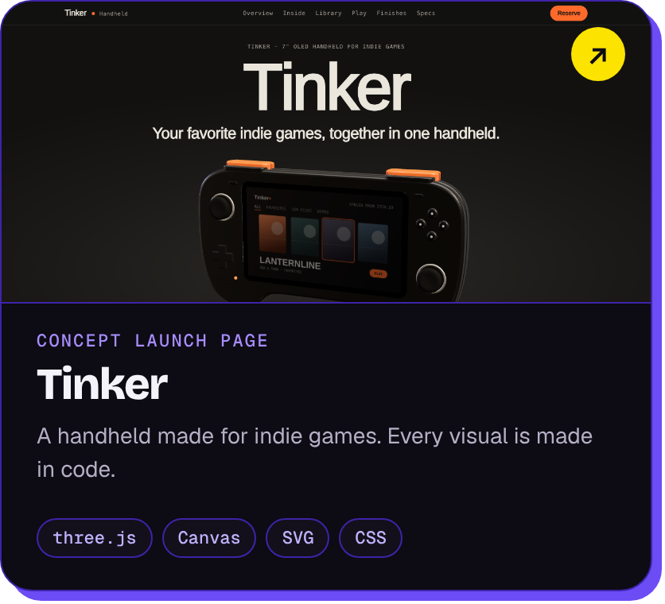</a>
<a href="https://victorvk.com/game/">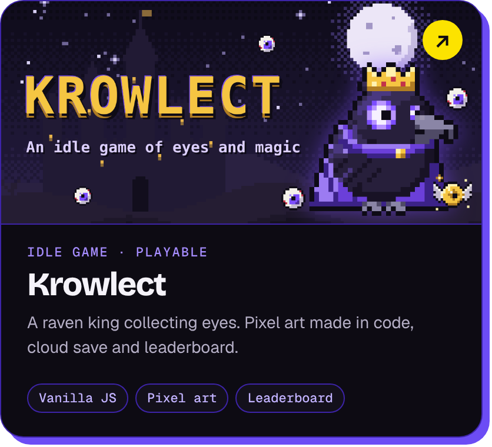</a>
<a href="https://github.com/Victorvkdev/multi-brand-email-builder">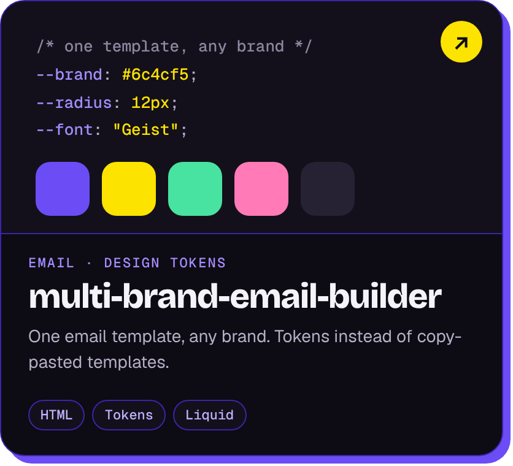</a>
<a href="https://github.com/Victorvkdev/cooldecode">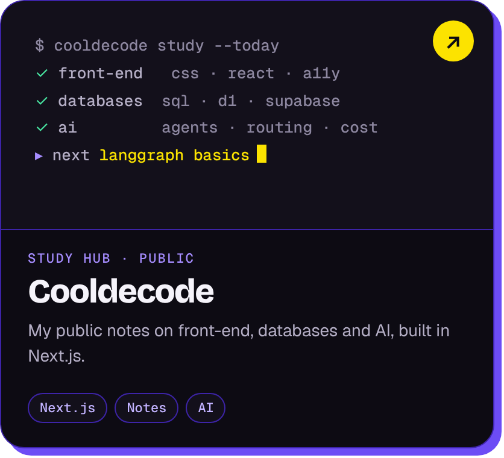</a>

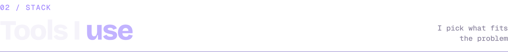

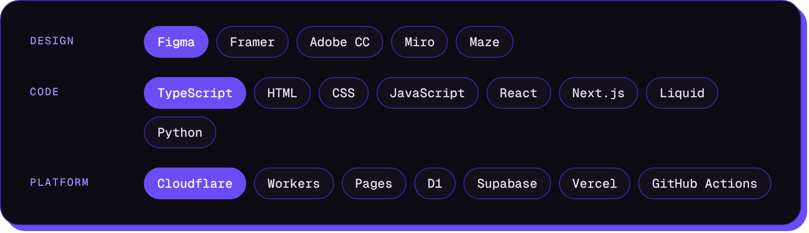

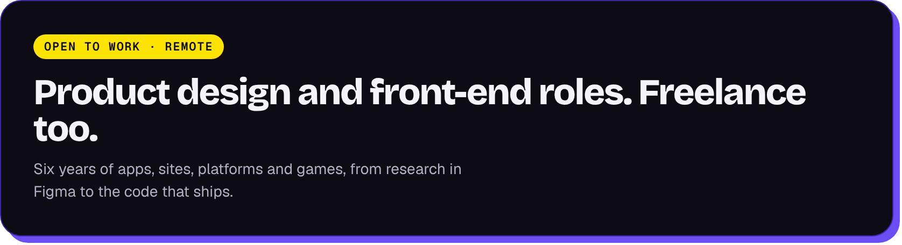

<a href="https://www.behance.net/victorvk">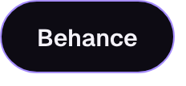</a>

Outside the screen: ravens, coffee, cats and RPGs, in about that order.
