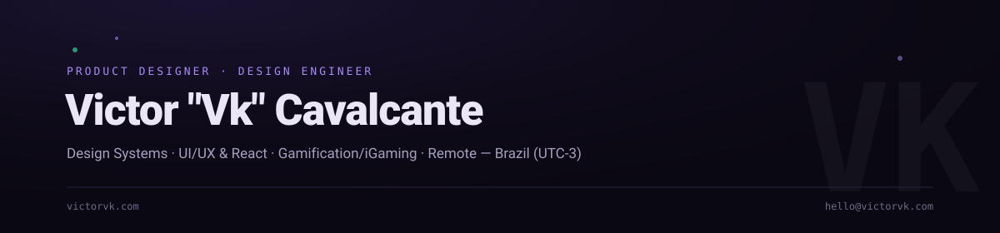

  

 

I design and build interfaces where the detail has a purpose — acquisition, retention, conversion. Background in game design shaped how I think about behavior: engagement loops, reward systems, the mechanics that keep people coming back. That instinct lives in every product decision I make now.

Currently working across design systems, CRM and gamification in iGaming — one of the most retention-driven product categories there is. Built a multi-brand tool from scratch that took campaign output from 1x to 6x.

I work end to end: mapping flows in Figma, prototyping real interfaces in Framer, writing the React/TypeScript that ships them.

 

### Currently building

**[multi-brand-email-builder](https://github.com/Victorvkdev/multi-brand-email-builder)** — a non-proprietary demo of the token-driven theming pattern behind that 1x→6x tool: one email template, three brands, zero duplication.

 

### Stack

  
  
  
  
  
  

### Connect

  
  
  

Open to remote roles across international teams where design is taken seriously and outcomes matter more than process.
