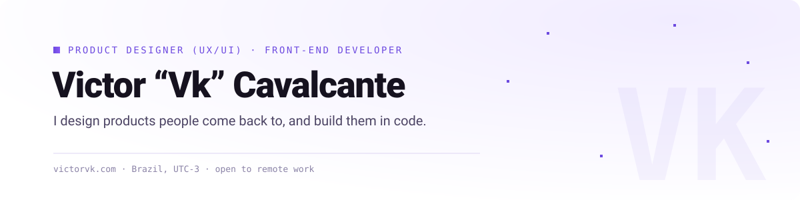

<picture>
  <source media="(prefers-color-scheme: dark)" srcset="./assets/banner-dark.svg">
  
</picture>

Hi, I'm Vk. I've spent 7 years designing apps, sites, platforms and games, 6 of them in product design and UI/UX.

I started in game development, and it still shapes how I work. Rewards, progress and a good first minute are what make people come back, in a game or in a product. I take a feature from research and flows in Figma all the way to the code that ships it.

Lately I've been working on onboarding, gamification and retention: loyalty hubs, missions, stores, the screens that turn a visit into a habit.

### What I'm building

| | |
|---|---|
| **[Nózito](https://github.com/Victorvkdev/nozito)** | A pixel-art virtual pet that lives inside [Énóis](https://enois.ia.br). Server-side rules, mini-games, Cloudflare + D1. Contributions welcome. |
| **[victorvk.com](https://github.com/Victorvkdev/victorvk-site)** | My portfolio. Static build with checks for broken links, alt text and headings, plus EN/PT pages. |
| **[Krowlect](https://victorvk.com/game/)** | An idle game about a raven king collecting eyes. Vanilla JS, pixel art made in code, cloud save and leaderboard. |
| **[multi-brand-email-builder](https://github.com/Victorvkdev/multi-brand-email-builder)** | One email template, any brand: design tokens instead of copy-pasted templates. |
| **[Cooldecode](https://github.com/Victorvkdev/cooldecode)** | My public study hub on front-end, databases and AI, in Next.js. |

### Tools I use

  
  
  
  
  
  
  
  
  
  

I don't stick to one stack. I pick what fits the problem.

### Outside the screen

Ravens, coffee, cats and RPGs, in about that order.

### Let's talk

I'm open to remote product design and front-end roles, and to freelance projects.

[victorvk.com](https://victorvk.com) · [LinkedIn](https://www.linkedin.com/in/victorvk/) · [Behance](https://www.behance.net/victorvk) · [hello@victorvk.com](mailto:hello@victorvk.com) · [Book a call](https://cal.com/victorvk/intro)
